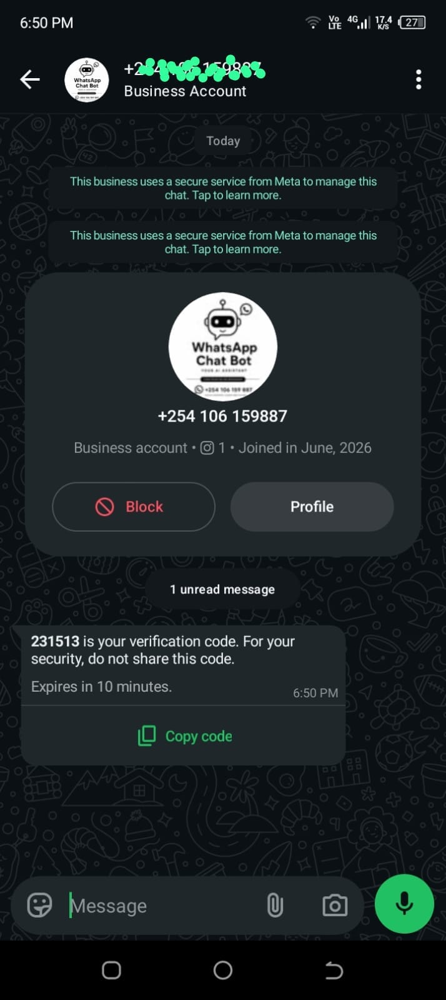

# WhatsApp OTP Verification using PHP and Meta API

This project demonstrates how to implement a user verification system using WhatsApp for sending One-Time Passwords (OTPs).

It is built with **PHP**, uses **MongoDB** for storing verification data, and integrates with the official **Meta WhatsApp Business API**.

WhatsApp message templates allow businesses to initiate conversations and send messages to contacts outside Meta's 24-hour customer service window, provided that the appropriate approved template is used.

---

## Features

- **Secure OTP Flow**: Generates an OTP, sends it through the WhatsApp API, and only saves the OTP to the database upon successful transmission.
- **Dynamic Country Codes**: Populates a searchable dropdown with country codes from a JSON file.
- **Phone Number Validation**: Validates phone number length based on the selected country.
- **AJAX-driven**: Provides a smooth user experience without requiring page reloads.
- **User-Friendly Interface**: Clean interface with SweetAlert2 notifications.
- **Environment-based Configuration**: Keeps sensitive credentials outside the source code using a `.env` file.
- **WhatsApp Authentication Templates**: Uses Meta-approved Authentication message templates for delivering OTP verification codes.
- **MongoDB Storage**: Stores OTP verification data securely in MongoDB.

---

## Prerequisites

- **PHP**: Version 7.4 or higher.
- **Web Server**: for local development).
- **Composer**: For managing PHP dependencies.
- **MongoDB**: A running MongoDB instance (local or a cloud service like MongoDB Atlas).
- **A Meta (Facebook) Developer Account**.
- **A WhatsApp Business Account**.
- **A registered phone number** that can make and receive WhatsApp calls/messages.

---

## Project Setup

### 1. Clone the Repository

```bash
git clone <your-repository-url>
cd <your-repository-folder>
```

### 2. Install Dependencies

Run Composer to install the required PHP libraries, including the MongoDB driver and Dotenv.

```bash
composer install
```

### 3. Configure Environment Variables

Create a `.env` file in the root of the project by copying the example file.

```bash
copy .env.example .env
```

Now, open the `.env` file and fill in your specific credentials.

```dotenv
# .env


# your permanent or temporary access token from the meta
WHATSAPP_TOKEN="YOUR_WHATSAPP_API_TOKEN"

# the Phone number id for your sending number, found in the Meta App Dashboard
PHONE_NUMBER_ID="YOUR_SENDER_PHONE_NUMBER_ID"


#mongodb atlas connection string
MONGODB_URI=""

# the name of the database we store 
MONGODB_DATABASE="whatsapp_verification"
```


---

# Meta & WhatsApp API Setup Guide

Setting up the WhatsApp API involves several steps across two different websites: the **Meta for Developers** site (`developers.facebook.com`) for app configuration and the **Meta Business Portfolio** (`business.facebook.com`) for managing business assets like phone numbers and message templates.

---

## Step 1: Prerequisites - A Facebook Account

You must have a personal Facebook account to create a Meta Developer account and a Meta Business Portfolio.

---

## Step 2: Create a Meta Business Portfolio

The Business Portfolio (formerly Business Manager) is where you manage all your business assets.

1. Go to the [Meta Business Suite](https://business.facebook.com/) and log in with your Facebook account.

2. If you don't have a Business Account, you will be prompted to create one. Follow the on-screen instructions to create your business portfolio. You'll need to provide a business name, your name, and a business email.

---

## Step 3: Create a Meta App

The app connects your code to Meta's services.

1. Go to [Meta for Developers](https://developers.facebook.com/) and click **My Apps**.

2. Click **Create App**.

3. Select **Other** as the use case, then select **Business** as the app type.

4. Provide an app name and your contact email.

5. Crucially, when prompted, select the **Business Portfolio** you created in the previous step to link the app to it.

---

## Step 4: Set Up the WhatsApp Product & Get Test Credentials

1. From your app's dashboard on the developer site, find the **WhatsApp** product and click **Set up**.

2. In the sidebar, under **WhatsApp**, click **API Setup**.

3. On this page, you will find your initial test credentials:

   - A temporary **Access Token** (expires in 24 hours).
   - A **Phone Number ID** associated with a test phone number provided by Meta.

These credentials are useful for initial testing but are not suitable for a production deployment.

---

## Step 5: Generate a Permanent Access Token (for Production)

For a live application, you need a token that doesn't expire.

1. Navigate to your **Meta Business Portfolio**:

   `business.facebook.com`

2. Go to **Settings > Business Settings**.

3. Under **Users**, click **System Users**.

4. **Add** a new System User. Give it a name, for example:

   `WebAppSystemUser`

   Set the role to **Admin**.

5. **Assign Assets**:

   - Select the System User you just created.
   - Click **Add Assets**.
   - In the **Select asset type** column, choose **Apps**.
   - Select your app from the list.
   - Enable the **Manage App** permission.

6. **Generate Token**:

   - Click the **Generate new token** button for that System User.
   - Select your app from the dropdown.
   - Under **Available permissions**, select:
     - `whatsapp_business_management`
     - `whatsapp_business_messaging`
   - Click **Generate Token**.
   - **Important:** Copy and save this token immediately. You will not be able to see it again.

This token becomes your production `WHATSAPP_TOKEN` value in the `.env` file.

> **Security warning:** Treat your access token like a password. Never place it directly inside PHP files, commit it to GitHub, or include it in screenshots.

---

# Step 6: Create the OTP Message Template

WhatsApp requires pre-approved templates for business-initiated messages such as OTP verification.

These templates are created and managed through the **Meta Business Portfolio**.

### 1. Open the Template Manager

From your app's dashboard on the developer site:

1. Go to **WhatsApp → API Setup**.
2. Look for the option that allows you to create your own message templates.
3. Follow the link to the template management section on `business.facebook.com`.

---

### 2. Create a New Template

Click **Create Template**.

Configure the template as follows:

- **Category**: **Authentication**
- **Name**: `otp1`
- **Language**: Select your desired language, for example **English (US)**.

> **Important:** The template name must match the template name used by the PHP application.

For example, if your PHP code sends:

```text
otp1
```

then your Meta template should also be named:

```text
otp1
```

---

## Authentication Template Configuration

Authentication templates are different from normal WhatsApp message templates.

Meta provides a standardized authentication message format to help prevent phishing and reduce the possibility of OTP messages being abused.

For this reason, you generally **cannot freely customize the message body** in the same way you can with Utility or Marketing templates.

Instead, Meta provides the authentication structure and allows you to configure options such as:

- OTP/code configuration
- Code length
- Expiration period
- Copy-code functionality, where available

The PHP application in this project generates a **6-digit OTP**, so the Authentication template should be configured to support a 6-digit verification code.

---

# Template Creation Example

The following screenshot shows how the Authentication template should look while creating/configuring it in Meta Business Portfolio.

### Creating the Authentication Template


> **Screenshot:** This image shows the template creation screen, including the **Authentication** category and the OTP configuration options.

---


After creating the template, you can open it from the template manager to view or edit its configuration.


## OTP Template Settings

When configuring the template, make sure the OTP settings are compatible with the OTP generated by the PHP application.

This project uses a **6-digit OTP**.

For example:

```text
123456
```

The OTP generated by the application is then passed to Meta through the WhatsApp Cloud API.

The Authentication template handles displaying the verification code to the recipient.

---

## Copy Code Button

If Meta provides the **Copy Code** option for your Authentication template, enabling it is highly recommended.

It allows the recipient to quickly copy the OTP from WhatsApp and paste it into the verification form.

This provides a smoother verification experience, especially on mobile devices.

---

## Submit for Approval

After configuring the Authentication template:

1. Review the template settings.
2. Click **Submit**.
3. Wait for Meta to review the template.

Authentication templates are generally designed specifically for verification use cases, but approval and review times can vary.

Once the template has been approved, the application can use it to send OTP messages.

---

# What the User Receives on WhatsApp

Once the application successfully generates an OTP and sends the request to Meta, the recipient receives the Authentication message directly in WhatsApp.

The message contains the verification code generated by the application.

### Example of the Received OTP Message



> **Screenshot:** This image shows what the OTP Authentication message looks like when it is received by the user in WhatsApp.

The recipient can then enter the OTP into the verification form on the website.

For example:

```text
Website
   ↓
Generate 6-digit OTP
   ↓
Send OTP through Meta WhatsApp Cloud API
   ↓
WhatsApp delivers Authentication template
   ↓
User receives OTP
   ↓
User enters OTP on website
   ↓
Application verifies OTP
   ↓
User is verified
```

---

# How the OTP Flow Works

The application follows a secure OTP workflow.

### 1. User Enters Phone Number

The user selects their country code and enters their WhatsApp phone number.

The application validates the number before continuing.

### 2. OTP Is Generated

The PHP application generates a random 6-digit verification code.

Example:

```text
483921
```

### 3. OTP Is Sent Through Meta

The application sends the OTP through the official Meta WhatsApp Business API using the approved Authentication template.

### 4. Message Delivery Is Checked

The application checks whether Meta successfully accepted the message request.

### 5. OTP Is Saved

The OTP is saved to MongoDB **only after the WhatsApp API successfully accepts the message for transmission**.

This prevents failed API requests from unnecessarily creating OTP records.

### 6. User Receives the Message

The recipient receives the WhatsApp Authentication message containing the verification code.

### 7. User Enters the OTP

The user enters the code into the verification form.

### 8. OTP Is Verified

The application compares the submitted OTP with the stored verification record.

If the OTP is correct and still valid, the user is successfully verified.

---

# Adding and Verifying a Phone Number for Testing

Before sending messages to a test number, you must add it to the verified recipient list.

1. Go back to the **API Setup** page on the **Meta for Developers** site (`developers.facebook.com`).

2. Scroll down to the **Send and receive messages** section.

3. Click the **To** field and select **Manage phone number list**.

4. Add a personal WhatsApp number.

5. Meta will send a verification code to that number on WhatsApp to confirm that you own it.

6. Once verified, the number can receive test messages from your application.

> **Note:** Meta's test environment has restrictions on which numbers can receive messages. Make sure the recipient number has been added and verified in the test configuration.

---

# Running the Application

### 1. Place the Project in Your Web Server

### 2. Open the Application

You should now see the verification form, ready to send OTPs!

---


# Technologies Used

- **PHP**
- **MongoDB atlas**
- **MongoDB php library**
- **Composer**
- **Meta WhatsApp Cloud API**
- **WhatsApp Authentication Message Templates**
- **AJAX**
- **JavaScript**
- **SweetAlert2**
- **HTML5**
- **CSS3**

---

# Important Notes About WhatsApp Templates

WhatsApp Business messaging is governed by Meta's policies and template requirements.

The available template categories, configuration options, approval process, and interface can change over time.

This project specifically uses an **Authentication template** for OTP delivery.

The template name configured in Meta must correspond to the template name referenced by the PHP API request.

For example:

```text
Meta Template Name:
otp1
```

should correspond to the template name used by the application:

```text
otp1
```

If the names do not match, Meta will reject the message request.

---

# Production Considerations

The credentials supplied by Meta during initial WhatsApp API setup are intended primarily for testing.

For a production application, you should configure:

- A production WhatsApp Business Account
- A production phone number
- A properly configured Business Portfolio
- A System User
- A suitable permanent access token
- An approved Authentication template
- HTTPS
- MongoDB Atlas or another production MongoDB deployment
- Rate limiting
- OTP expiration
- Secure session handling
- Proper error logging

---

# Troubleshooting

### Message Is Not Being Received

Check the following:

1. The recipient number has been added and verified for testing.
2. The WhatsApp phone number ID is correct.
3. The access token is valid.
4. The Authentication template has been approved.
5. The template name matches the name used in the PHP code.
6. The selected template language matches the language sent by the application.
7. The generated OTP format is compatible with the Authentication template.
8. Check the response returned by the Meta Graph API.

---

### Template Not Found

If Meta reports that the template cannot be found, verify:

```text
Template name
Template language
WhatsApp Business Account
Phone Number ID
Access Token
```

For example, if the application sends:

```text
otp1
```

make sure an approved template named:

```text
otp1
```

exists in the WhatsApp Business Account associated with the phone number ID.

---

### OTP Was Not Saved to MongoDB

The application intentionally saves the OTP only after the WhatsApp API request succeeds.

If the OTP is not being saved, check the Meta API response first.

A failed WhatsApp API request should not result in a valid OTP being stored for the user.


# Conclusion

This project provides a practical example of implementing WhatsApp-based OTP verification using **PHP, MongoDB, and the official Meta WhatsApp Business API**.

It demonstrates the complete flow from collecting and validating a user's phone number, generating an OTP, sending it through an approved WhatsApp Authentication template, storing the verification data, and finally verifying the user.

The included screenshots also demonstrate how the Authentication template is configured in Meta Business Portfolio and what the final OTP message looks like when received by the user on WhatsApp.